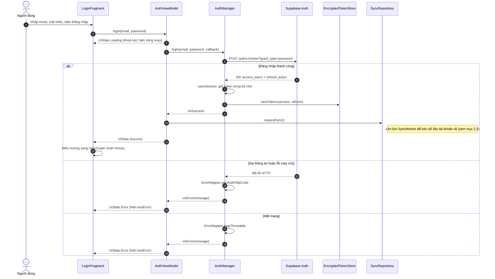
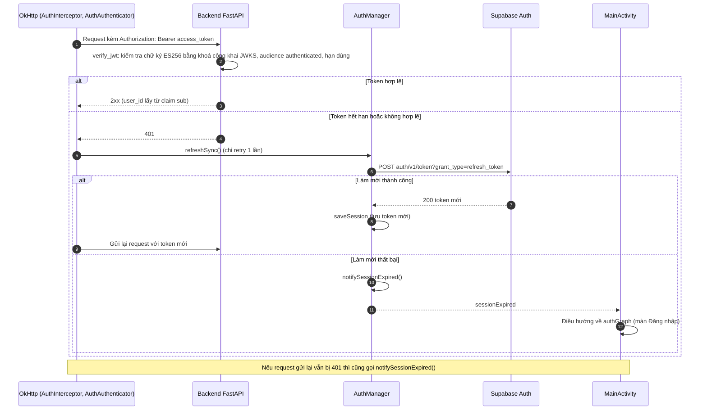
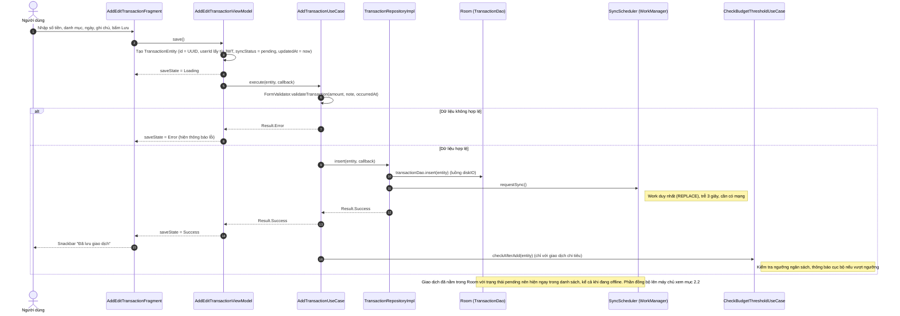
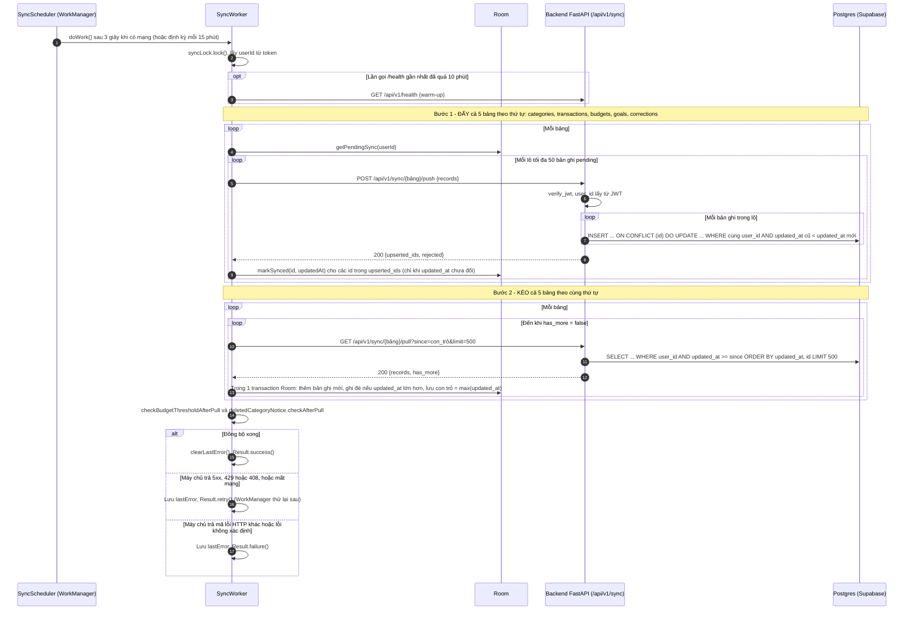

# Sơ đồ trình tự (Sequence Diagram)

Tài liệu mô tả 4 luồng chính của Plix theo đúng code hiện tại: Android Java (MVVM) và Backend FastAPI. Sơ đồ viết bằng Mermaid, GitHub tự hiển thị.

Quy ước chung: Fragment gọi ViewModel, ViewModel gọi UseCase, UseCase gọi Repository, Repository đọc ghi Room hoặc gọi API. Mũi tên liền là lời gọi, mũi tên đứt là kết quả trả về.

## 1. Đăng nhập

### 1.1 Đăng nhập bằng Supabase Auth

Nguồn code: `LoginFragment`, `AuthViewModel`, `AuthManager`, `EncryptedTokenStore`, `ErrorMapper`, `SyncRepository`.

### 1.2 Dùng JWT khi gọi backend và tự làm mới token

Nguồn code: `AuthInterceptor`, `AuthAuthenticator`, `AuthManager`, `MainActivity`, `backend/app/core/security.py` (`verify_jwt`).

## 2. Thêm giao dịch và đồng bộ

### 2.1 Thêm giao dịch (lưu cục bộ trước)

Nguồn code: `AddEditTransactionFragment`, `AddEditTransactionViewModel`, `AddTransactionUseCase`, `FormValidator`, `TransactionRepositoryImpl`, `SyncScheduler`, `CheckBudgetThresholdUseCase`. Bước kiểm tra chi tiêu bất thường (AI) sau khi lưu không thuộc luồng này nên không vẽ.

### 2.2 Đồng bộ lên máy chủ (đẩy rồi kéo)

Nguồn code: `SyncScheduler`, `SyncWorker`, `SyncPusher`, `SyncPuller`, `SyncTables`, `backend/app/routers/sync.py`, `backend/app/services/sync_service.py`.