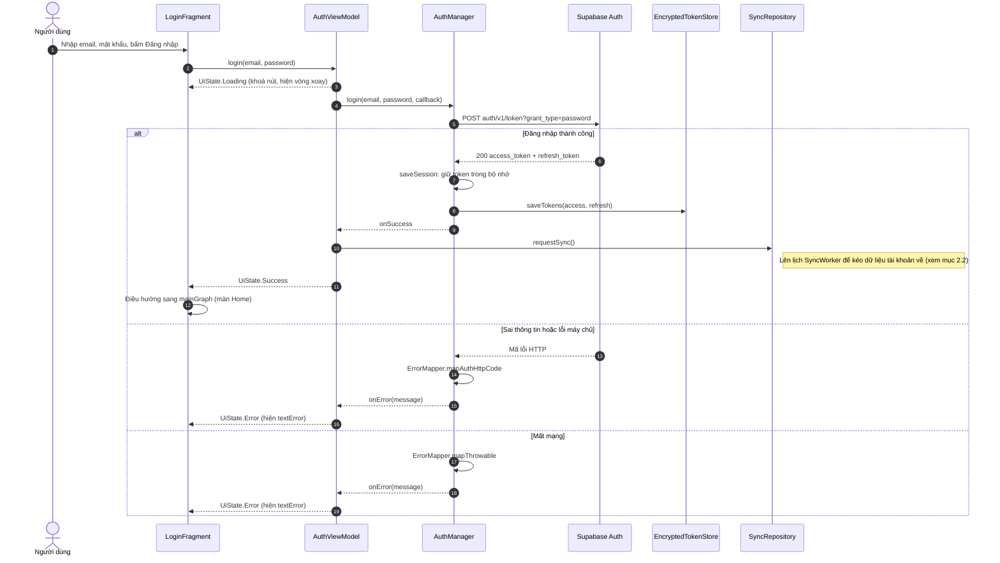
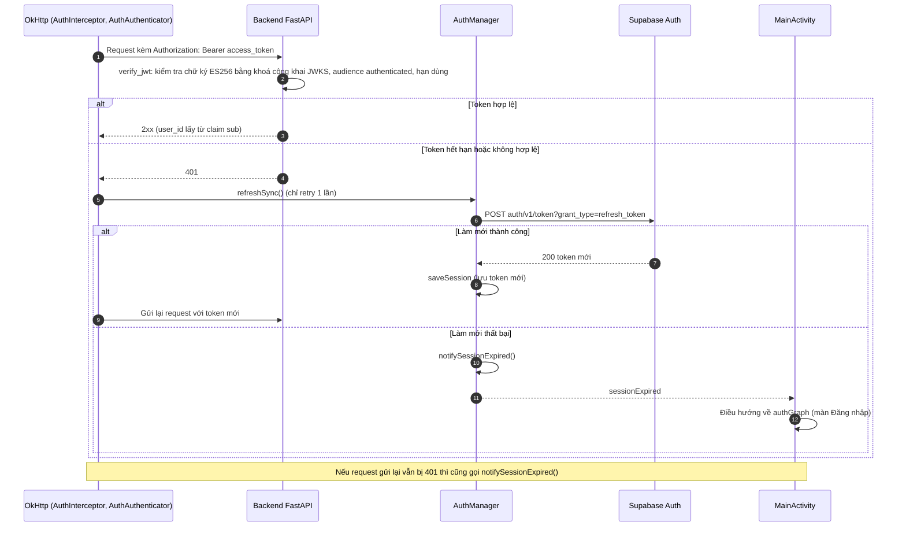

# Sơ đồ trình tự (Sequence Diagram)

Tài liệu mô tả 4 luồng chính của Plix theo đúng code hiện tại: Android Java (MVVM) và Backend FastAPI. Sơ đồ viết bằng Mermaid, GitHub tự hiển thị.

Quy ước chung: Fragment gọi ViewModel, ViewModel gọi UseCase, UseCase gọi Repository, Repository đọc ghi Room hoặc gọi API. Mũi tên liền là lời gọi, mũi tên đứt là kết quả trả về.

## 1. Đăng nhập

### 1.1 Đăng nhập bằng Supabase Auth

Nguồn code: `LoginFragment`, `AuthViewModel`, `AuthManager`, `EncryptedTokenStore`, `ErrorMapper`, `SyncRepository`.

### 1.2 Dùng JWT khi gọi backend và tự làm mới token

Nguồn code: `AuthInterceptor`, `AuthAuthenticator`, `AuthManager`, `MainActivity`, `backend/app/core/security.py` (`verify_jwt`).