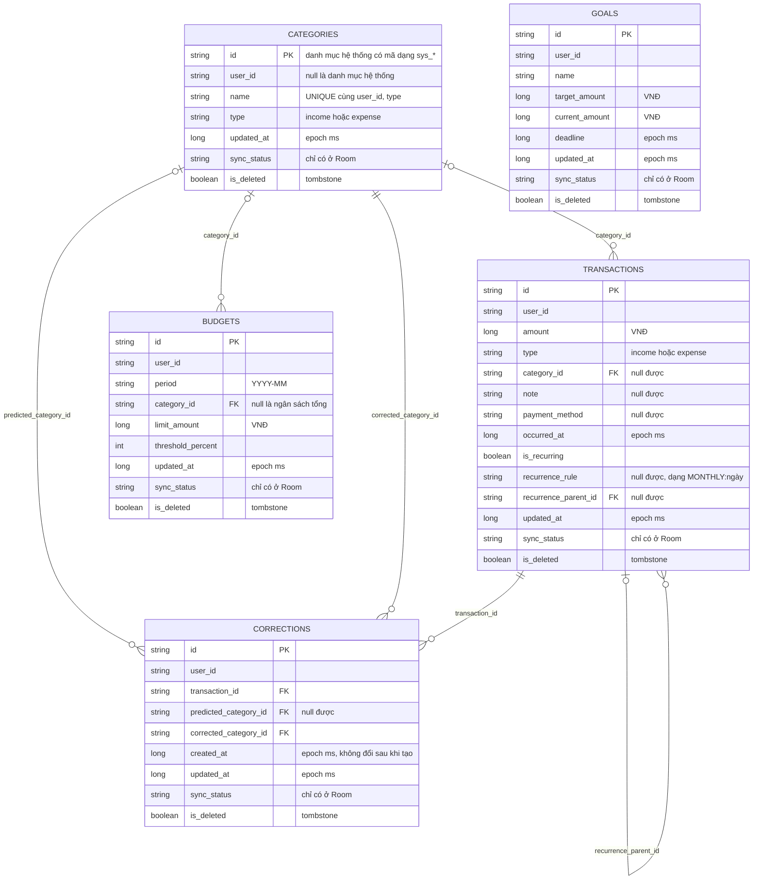

# Sơ đồ quan hệ thực thể cơ sở dữ liệu — Plix

**Người thực hiện:** Nguyễn Phi Long
**Nguồn đối chiếu:** 5 lớp Entity trong `android/app/src/main/java/com/longvuong/plix/data/local/entity/`, `backend/sql/01_core_sync_tables.sql`, `docs/SYNC_PAYLOAD_SCHEMA.md`.

Phạm vi: 5 bảng tham gia đồng bộ gồm `transactions`, `categories` (Danh mục), `budgets`, `goals`, `corrections`.

## Chú giải

- **Quan hệ:** `|o--o{` nghĩa là "một danh mục có thể có nhiều giao dịch, còn mỗi giao dịch có tối đa một danh mục" (cột tham chiếu được phép `null`). `||--o{` nghĩa là bắt buộc phải có (ví dụ mỗi correction luôn có `transaction_id` và `corrected_category_id`).
- **Khoá ngoại:** Room và SQL Postgres **không khai báo ràng buộc khoá ngoại**; các đường nối và ký hiệu `FK` là quan hệ tham chiếu theo thiết kế. Thứ tự đồng bộ `categories → transactions → budgets → goals → corrections` đi theo các quan hệ này.
- **`user_id`:** có ở cả 5 bảng, là mã người dùng lấy từ claim `sub` của JWT Supabase Auth. Tài khoản nằm ở Supabase Auth, ngoài 5 bảng nên không vẽ thành thực thể.
- **Ràng buộc duy nhất:** `categories` có `UNIQUE(user_id, name, type)`; `budgets` có `UNIQUE(user_id, period, category_id)`.
- **`goals`:** không có cột `status`; trạng thái mục tiêu được tính ở tầng UseCase mỗi lần đọc.
- **`sync_status`, `is_deleted`:** `sync_status` chỉ có ở Room (không có ở Postgres). `is_deleted` là xoá mềm (tombstone), cả 5 bảng đều có.
- **Kiểu dữ liệu:** ghi theo Room (Java). Ở Postgres: `long` là `BIGINT`, `boolean` là `BOOLEAN`, `int` là `INTEGER`, `string` là `TEXT`.
- **Ngoài ERD:** Postgres còn bảng `ai_model_params` (tham số mô hình AI của từng người dùng) và `anomaly_stats` (đã tạo nhưng MVP chưa dùng). Hai bảng này không đồng bộ và không có ở Room nên không thuộc phạm vi ERD.