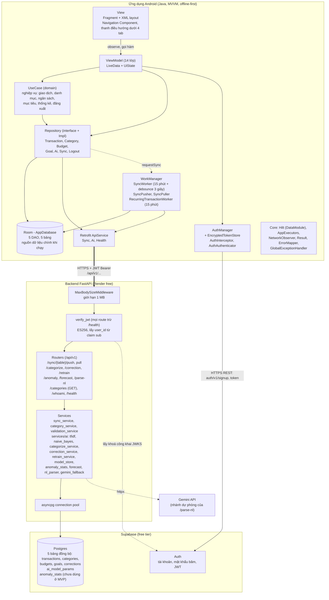

# Sơ đồ kiến trúc hệ thống — Plix

**Người thực hiện:** Nguyễn Phi Long
**Nguồn đối chiếu:** mã nguồn trong `android/` và `backend/`.

## Chú giải

- **MVVM trong ứng dụng:** View chỉ hiển thị và bắt sự kiện; ViewModel giữ trạng thái màn hình; UseCase chứa nghiệp vụ (không dùng `Context`, `View`, `LiveData`); Repository quyết định đọc/ghi Room hay gọi Retrofit. Tầng `presentation` và `domain` không gọi trực tiếp DAO hay ApiService.
- **Ghi dữ liệu (offline-first):** mọi thay đổi ghi vào Room trước với `sync_status = pending`; `SyncWorker` đẩy lên máy chủ sau.
- **Đồng bộ:** `SyncWorker` đẩy lần lượt 5 bảng theo thứ tự `categories → transactions → budgets → goals → corrections` (mỗi lô 50 bản ghi), rồi kéo về theo cùng thứ tự (mỗi lô tối đa 500 bản ghi).
- **Xác thực:** ứng dụng đăng nhập qua Supabase Auth (REST) để nhận JWT; mọi request tới backend gắn JWT; backend xác minh chữ ký bằng khoá công khai JWKS của Supabase và lấy `user_id` từ claim `sub`, không tin `user_id` do client gửi.
- **AI:** chạy ở backend (phân loại, sửa gợi ý, huấn luyện lại, bất thường, dự báo, phân tích câu nhập nhanh). Gemini chỉ là nhánh dự phòng của `/parse-nl`.
- **Cơ sở dữ liệu cloud:** chỉ backend truy cập Postgres (qua `asyncpg`); ứng dụng Android chỉ gọi Supabase cho phần Auth.