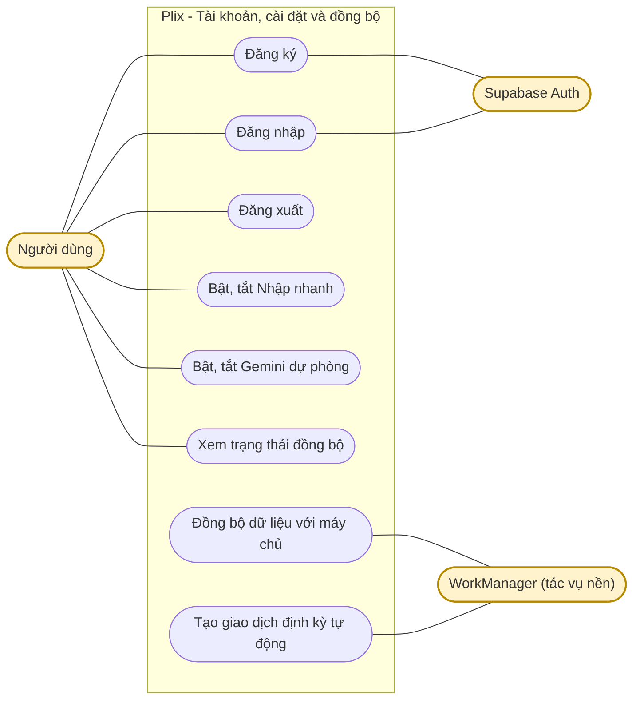
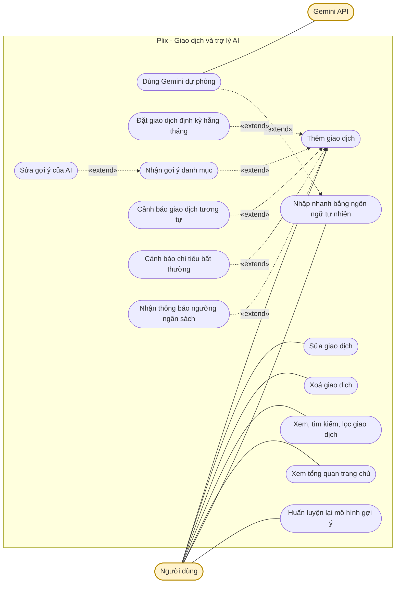
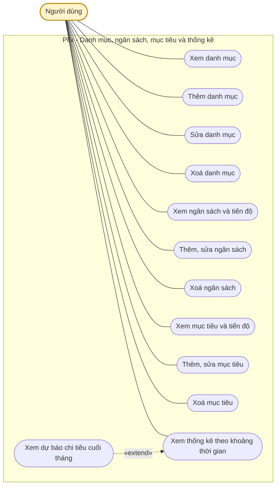

# Sơ đồ Use Case

Tài liệu mô tả các chức năng người dùng thực hiện được trong Plix (ứng dụng Android và Backend FastAPI). Sơ đồ chia làm 3 phần cho dễ đọc, viết bằng Mermaid, GitHub tự hiển thị.

## Tác nhân (Actor)

| Tác nhân | Vai trò |
|---|---|
| Người dùng | Tác nhân chính, dùng ứng dụng Plix |
| Supabase Auth | Hệ thống bên ngoài, xác thực khi đăng ký và đăng nhập |
| Gemini API | Hệ thống bên ngoài, chỉ được gọi khi người dùng bật Gemini dự phòng cho Nhập nhanh |
| WorkManager | Tác vụ nền của Android, tự chạy đồng bộ và tạo giao dịch định kỳ |

Quy ước: đường liền là quan hệ giữa tác nhân và use case, đường đứt «extend» là use case mở rộng thêm cho use case gốc.

## 1. Tài khoản, cài đặt và đồng bộ

## 2. Giao dịch và trợ lý AI

## 3. Danh mục, ngân sách, mục tiêu và thống kê

